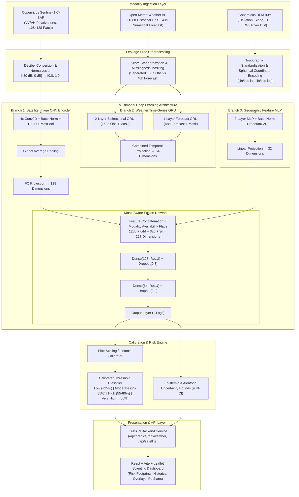

# GlobalFlood AI Architecture

## System Overview

GlobalFlood AI is a multimodal deep learning system designed for 48-hour global flood forecasting. The system integrates three heterogeneous spatial and temporal data streams:
1. **Copernicus Sentinel-1 SAR** (Synthetic Aperture Radar) backscatter imagery (VV and VH polarizations) at 10m spatial resolution.
2. **Open-Meteo High-Resolution Numerical Weather Predictions** (168h historical observations + 48h future forecast).
3. **Copernicus DEM (90m)** providing elevation, slope, terrain roughness (TRI), and topographic wetness (TWI).

## Modality Specifications

| Modality | Sensor / Source | Spatial Resolution | Temporal Frequency | Representation / Output |
| :--- | :--- | :--- | :--- | :--- |
| **SAR Imagery** | Sentinel-1 C-SAR (IW GRD) | 10 meters | 6-12 day repeat orbit | 128x128 patch, 2 channels (VV, VH) &rarr; 128-d embedding |
| **Historical Weather** | Open-Meteo Reanalysis | ~11 km (0.1°) | Hourly (168 hours) | 6 variables (rain, temp, humidity, pressure, wind, soil) + mask &rarr; 64-d GRU |
| **Forecast Weather** | Open-Meteo GFS/ECMWF | ~11 km (0.1°) | Hourly (48 hours) | 6 variables (forecast rain, temp, humidity, pressure, wind) + mask &rarr; 64-d GRU |
| **Terrain Topography** | Copernicus DEM / Open-Elevation | 90 meters | Static WGS84 | Elevation, Slope, TRI, TWI, River Distance, Sin/Cos Lat/Lon &rarr; 32-d MLP |
